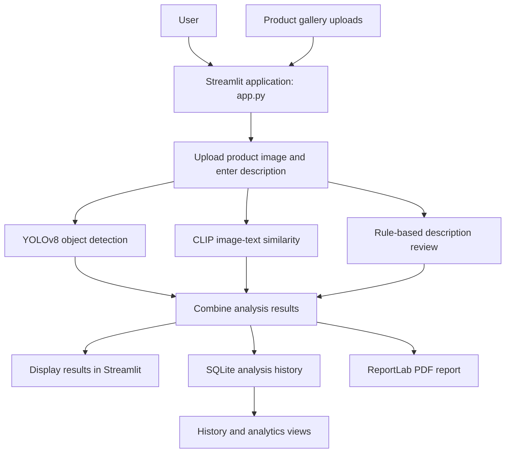

# System Architecture

## High-level workflow

## Component responsibilities

| File | Responsibility |
|---|---|
| `app.py` | Streamlit interface, input handling, orchestration, result display, analytics, history, and gallery |
| `image_detection.py` | Loads YOLOv8 and returns detected object labels and confidence values |
| `visual_search.py` | Loads and caches CLIP, compares the uploaded image with predefined text candidates, and ranks the scores |
| `policy_checker.py` | Searches product descriptions for configured demonstration phrases |
| `history.py` | Creates and queries the SQLite analysis database |
| `report_generator.py` | Builds a PDF summary of detection, similarity, and policy-review results |

## Data flow

1. The user supplies an image and product description through Streamlit.
2. The application passes the image to YOLOv8 and CLIP, and the description to the rule-based checker.
3. The application displays the outputs and saves a record in SQLite.
4. The report generator creates a downloadable PDF.
5. The history and analytics sections read saved records from SQLite.

## Interpretation and safeguards

- YOLO labels indicate model detections, not verified product identity.
- CLIP scores rank the supplied candidate descriptions; they are not calibrated probabilities.
- Policy phrase matches are preliminary review signals, not official policy determinations.
- Human review is required before making business, marketplace, or compliance decisions.
